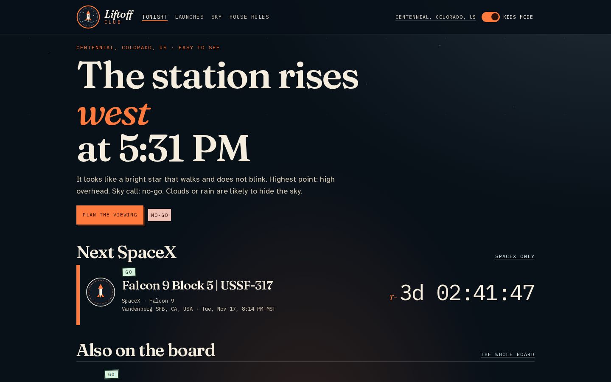
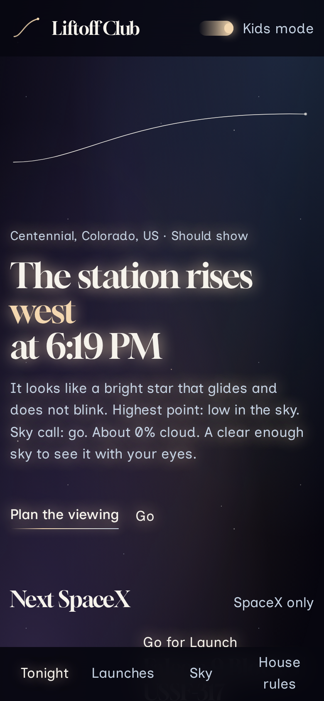
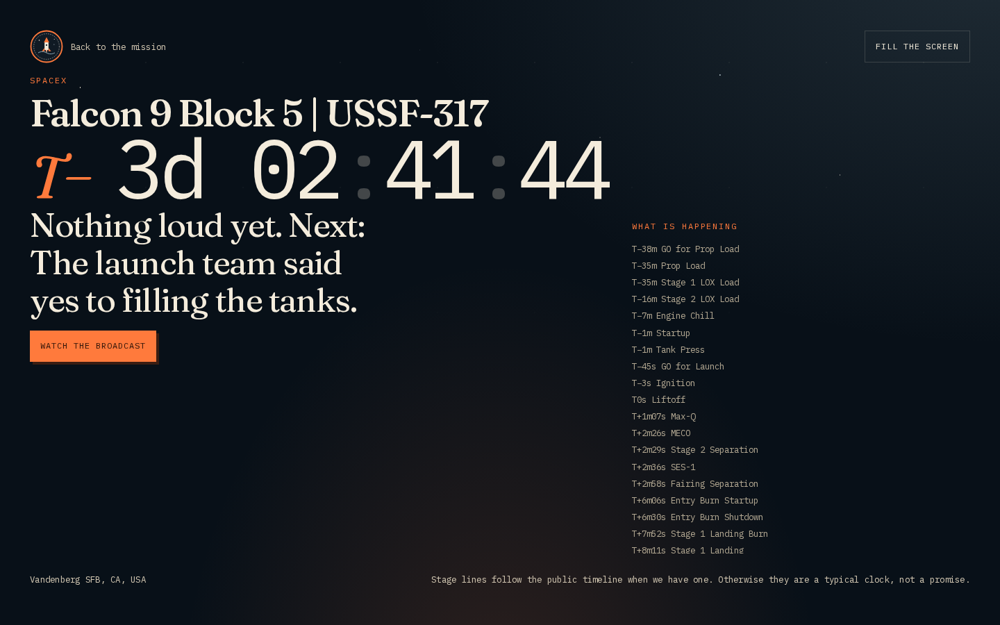

# Liftoff Club

A family companion for rocket launches and the night sky.

Live site: [https://liftoffclub.app](https://liftoffclub.app)

Liftoff Club covers launches worldwide. It is built for a kitchen table in Centennial, Colorado: a seven year old can follow the story, and a grown up still gets the pad, the rocket, and an honest answer about whether anyone in the house can see it. There are no accounts, no ads, and no required API keys. Your town stays in the browser.

The story of the build, in plain language, is at [/about/build](https://liftoffclub.app/about/build).

## What it feels like

Night sky, solid type, and a launch trail. Text does not glow. Mission marks are drawn for the club. They are not copies of anyone’s logo.








## Stack

- Next.js App Router, React, TypeScript
- Vercel for hosting
- Self hosted type: Gloock for titles, Inclusive Sans for reading, Barlow for labels and figures (SIL Open Font License)
- satellite.js, plain JavaScript build, for pass estimates
- Optional Vercel Web Analytics. Query strings are stripped. No cookies are required for the family site

## Data sources

- [The Space Devs, Launch Library 2](https://thespacedevs.com/llapi) for launches, pads, timelines, and descriptions. Cached for about an hour. A saved board is used if the feed is resting.
- [CelesTrak](https://celestrak.org) for public orbital elements and in orbit counts.
- [Natural Earth](https://www.naturalearthdata.com/) land for the mission view globe. The path is labeled approximate.
- [Open Meteo](https://open-meteo.com) for geocoding and cloud cover. No key.
- Rocket photos only under public domain, CC0, CC BY, or CC BY SA, each with author, license, and source. Other rockets use a drawn trail.

A number is shown only with a source and a date. Otherwise the line says no public figure yet. A coarse launch time says the clock is not set instead of inventing an hour.

## Try it

You need Node.js 20 or newer.

```bash
npm install
npm test
npm run lint
npm run build
npm start
```

Open [http://localhost:3000](http://localhost:3000). Kids mode is already on. Parent controls are under For parents.

## Deploy

1. Import this GitHub repo in the Vercel team `partiqules-projects` as the project `liftoff-club`. Framework preset: Next.js.
2. The production domain is `liftoffclub.app`. `www` redirects to the apex. `liftoff-club.vercel.app` keeps working.
3. Set `NEXT_PUBLIC_SITE_URL` to `https://liftoffclub.app` so calendar links and metadata use the public site.
4. No other variable is required. Optional ones are in `.env.example`: `LL2_API_TOKEN` for a higher Launch Library limit, and `EXPLAINER_API_KEY` if a model should draft a story. Without that key, stories come from the listing. Never commit a real key.

## What the family app does

- Upcoming launches worldwide, with the next flight called out on the home page.
- A launch page, a full screen launch day, and a mission view with an approximate path.
- Kids mode, on by default.
- A saved town. “Can we see this launch from here?” says when the answer is no.
- Tonight’s station passes and a small Starlink sample, with a go, maybe, or no go from cloud cover.
- Alerts while this tab is open, quiet hours, and a calendar feed that updates when a clock moves.
- Follow a company in this browser. Company pages are public and unclaimed.
- Constellation counts at `/constellations`, cited or left blank.
- Glossary cards for countdown words.

## Pro

`/pro` is a desk for space industry teams: a watchlist, a cited constellation tracker, manifest filters with CSV export, local alert rules, and a one page brief. It does not take payment. Saved targets stay in the browser. The family site stays free.

## Tests

```bash
npm test
```

Covers pass prediction, visibility, calendar ids, quiet hours, cited figures, mission clock math, photo licenses, and the case study copy.

## License

MIT. Copyright 2026 Paul Miller.
