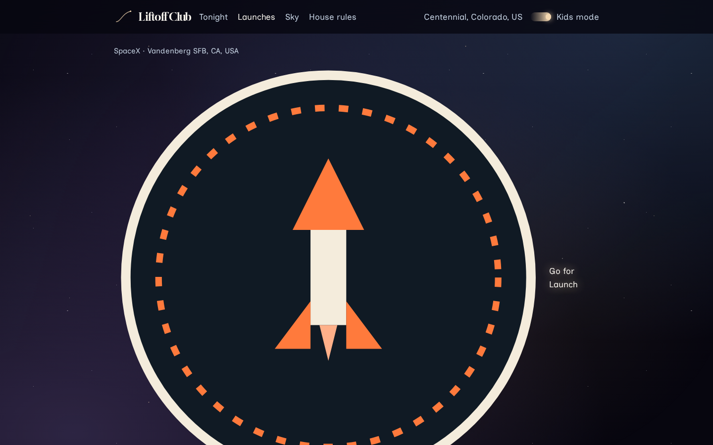
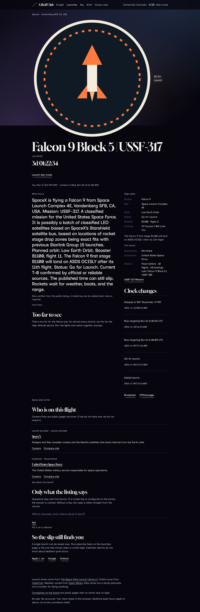
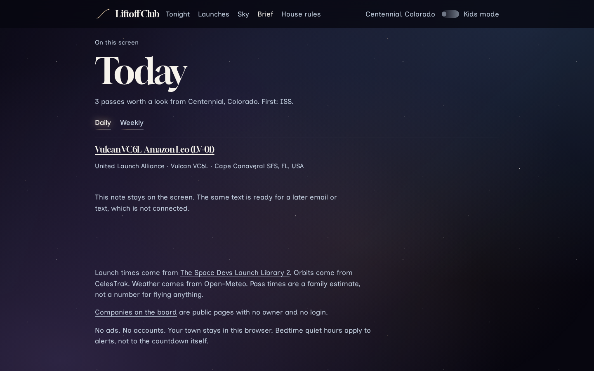
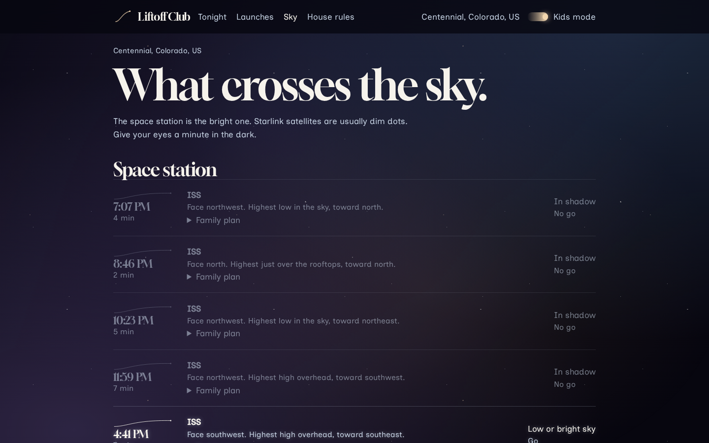
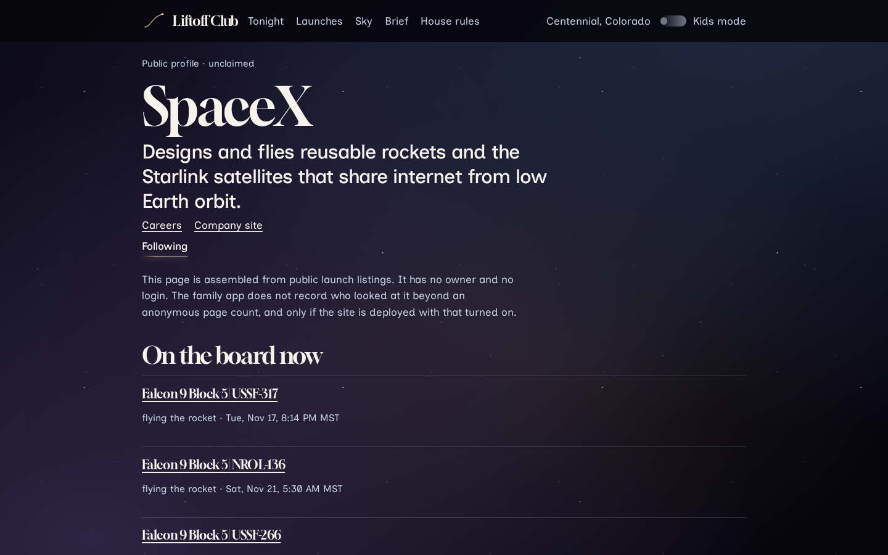

# Liftoff Club

A family companion for rocket launches and the night sky.

Liftoff Club covers launches worldwide and keeps SpaceX easy to find. It is built for a kitchen table: a seven-year-old can follow the story, and a grown-up still gets the pad, the booster, and an honest answer about whether anyone in the house can actually see it.

There are no accounts, no ads, and no required API keys. Your town stays in the browser.

## What it feels like

Night sky, one warm signal color, and type set like a storybook next to a mission clock. Mission patches are drawn for the club. They are not copies of anyone’s logo.













## Try it on your computer

You need Node.js 20 or newer.

```bash
npm install
npm test
npm run lint
npm run build
npm start
```

Open [http://localhost:3000](http://localhost:3000). Type a city (Centennial works) or use the device location. Kids mode is already on. Parent controls are under For parents in the nav. Night red is there too, for watching outside.

`npm run dev` is there for day-to-day changes.

## Deploy it (Paul)

1. Push this branch, or merge the pull request into `main`.
2. In Vercel, choose **Add New Project** and import this GitHub repo. Framework preset: Next.js. No environment variables are required.
3. Deploy. The free tier is enough.
4. In the Vercel project, open **Analytics** and turn on **Web Analytics** if it is not already on. No key. The app already includes the package, and it strips query strings before anything is counted. Until you deploy, analytics stays quiet.
5. Optional, only if you want them later:
   - `NEXT_PUBLIC_SITE_URL` — the public https address, so calendar subscribe links use the real site. If you leave it blank, Vercel’s own URL is used.
   - `LL2_API_TOKEN` — a Launch Library 2 token if the free hourly limit ever feels tight. The app caches and works without it.
   - `EXPLAINER_API_KEY` — an OpenAI-compatible key if you want the kid stories drafted by a model. Without it, stories are written from the launch data. See `.env.example`. Never commit a real key.

After deploy, subscribe to `https://your-site/calendar/feed.ics` from the launches page. When a rocket slips, the same calendar event moves. Apple, Google, and Outlook refresh on their own schedule, often slower than an hour.

## What version 1 does

- Upcoming launches worldwide, with the next SpaceX flight called out on the home page.
- A launch page: plain-language story, flight plate, webcast, official page. Grown-up mode adds booster history, orbit and destination, customers, every webcast, and public notes about scrubs or delays when the listing has them.
- Kids mode, on by default. The grown-up version is the same page with the fuller account.
- Saved alert rules on this device: any Starship, anything we might see from here, and a one hour reminder that includes the sky call.
- A daily and weekly brief on its own page. It is the same text a later email or text could send. Nothing is sent.
- Follow a company on its public page. The list of who is flying what stays in this browser.
- “Ask about this launch” on the grown-up page. Answers come only from that launch’s listing. A model is used only if `EXPLAINER_API_KEY` is set, and the reply is cached. With no key, the answer is read from the record.
- Space words. Calls such as Max Q, MECO, SECO, fairing separation, scrub, T minus, LEO, GEO, SSO, RTLS, and droneship are tappable on a launch, its timeline, and launch day. The card has a grown up line and a kids line. Words you open are saved in this browser, and the full list is at `/glossary`.
- Constellations at `/constellations`. How many satellites are in orbit is counted from CelesTrak. A stated size or capacity appears only with a source and a date. Otherwise the line says no public figure yet.
- An “AI in orbit” line on a launch or a company only when a public source says that mission runs a model on the spacecraft.
- Rocket photos on launch pages and at `/rockets`. Only public domain, CC0, CC BY, and CC BY-SA. Each picture has the author, the license, and a source link. Rockets without one of those licenses get a drawn fallback.
- A payload and customer list (“space jobs corner”) with a short brief and a careers link when we actually have one.
- A saved town or device location. It never leaves the browser for an account, because there isn’t one.
- Tonight’s International Space Station passes, plus a small sample of Starlink passes: direction, time, how high, and an honest grade.
- A go / maybe / no-go from cloud cover (Open-Meteo, no key).
- A family plan: when to go out, which way to face, what to bring.
- “Can we see this launch from here?” Distance, direction, daylight, and a clear “too far” when that is the truth.
- Launch day mode: a full-screen clock and a line for what is happening now. Real timeline calls when the feed has them.
- Add to Apple (.ics), Google, and Outlook on every launch, plus a subscribable feed that keeps a stable id so slips update the event.
- Alert opt-in with filters: provider, “only if we might see it,” sky passes, and bedtime quiet hours. Alerts fire while the tab is open, and on phones that allow alerts from an installed web app. A sleeping phone may stay quiet. The calendar is the reliable nudge.
- Parent controls: kids mode, quiet hours, erase saved settings. No kid accounts. No personal data collection.

## What is stubbed

- **Model-written stories and answers.** The seams are `lib/explain.ts` and `lib/ask.ts`. Set `EXPLAINER_API_KEY` and the server will call an OpenAI-compatible chat endpoint, cache the result, and fall back to the listing if the call fails. With no key, nothing is invented.
- **Email or text briefs.** The brief page already builds the message (`lib/brief.ts`, channel `screen`). A sender for email or text is not connected.
- **Push notifications when the phone is asleep.** The browser permission, filters, quiet hours, and a small service worker are in place. There is no push server, on purpose: that would be another account and another key.
- **Higher Launch Library rate limits.** One cached request an hour is the design. A token is optional.

Pass times are a family estimate from public orbits. They can be off by a couple of minutes. They are not for flying anything.

“Can we see the launch?” is a distance-and-daylight guess. Close pads, night launches, and the occasional twilight plume are treated differently. It will tell you when Centennial cannot see a Florida rocket.

Starlink is a sample of recent, lower satellites spread across orbit planes, not all several thousand. The bright show is still the space station. A fresh Starlink train just after a launch can be brighter than this sample suggests.

## Architecture

Next.js App Router, TypeScript, React server components, and a few client islands for the town, the clock, and the sky.

```
app/                pages, calendar feed, orbit endpoint
components/         logo, patches, flight strips, launch-day screen
lib/launches.ts     Launch Library 2, memory + file cache, saved fallback
lib/companies.ts   stable company ids and slugs, separate from the pages
lib/company-board.ts  which launches name a company
lib/explain.ts      kid and adult stories; optional model behind a cache
lib/predict.ts      pass finding with satellite.js (pure-JS SGP4, not the WASM entry)
lib/tle.ts          CelesTrak ISS + a reduced Starlink set, cached 12 hours
lib/visibility.ts   “can we see it from here?”
lib/calendar.ts     .ics files and the subscribe feed
lib/alerts.ts       which reminder is due, including bedtime
data/               saved launch board used if the live feed is resting
```

Location, kids mode, and quiet hours live in `localStorage` (`liftoff-club-v1`). Weather and city search go from the browser straight to Open-Meteo. Launch data is fetched on the server so every visitor shares one cached pull.

The free Launch Library allows about 15 requests an hour per IP. The app keeps a result for about 50 minutes, in memory and on disk, and falls back to `data/launches-fallback.json` if the feed answers 429 or is down. A small banner says when you are looking at a saved board.

## Data sources

Please keep these credits if you fork the app.

- [The Space Devs, Launch Library 2](https://thespacedevs.com/llapi) for launches, pads, timelines, and descriptions. Development snapshots can be refreshed with `npx tsx scripts/refresh-fallback.ts`.
- [CelesTrak](https://celestrak.org) for public orbital elements (ISS and Starlink). Cached, with a named user agent.
- [Open-Meteo](https://open-meteo.com) for geocoding and hourly cloud cover. No key.
- [satellite.js](https://github.com/shashwatak/satellite-js) for SGP4 propagation.

Photos are not embedded. Webcasts and official pages are linked out.

## Design

The look is one system: a deep field and a launch trail. Principles, including the self hosted typefaces and their licenses, live in [docs/DESIGN.md](docs/DESIGN.md).

Company pages live at `/companies` and `/companies/[slug]`. A slug is the company id (`spacex`, `united-launch-alliance`). “ULA” and “United Launch Alliance” are the same id. Starlink is a payload name on SpaceX, not a second company. Pages are public and unclaimed: `claimedBy` is always null. There is no company login. Vercel Web Analytics, if you turn it on, counts page views in aggregate and the app strips query strings first. It does not keep a profile of who looked.

## Roadmap (not built)

The family app stays free and ad-free. A later paid product in this same repo, working title **Liftoff Club Pro**, would be a second app for small space companies’ business teams: company profiles they can claim, who flies with whom, manifest trends, watchlists, alerts on new launches or contracts, and CSV export. It is not in this version. The seams that make it possible are already here:

- Launch, payload, and company records are plain data in `lib/`, not buried in components.
- Every company has a stable id and slug, including names that only appear in the live feed.
- Each company already has a public profile route a business could later claim, without inventing a new URL.
- Alerts already have a filter object. Pro would add a different audience, not a new idea of “what changed.”
- View counts stay aggregate and anonymous. Do not add accounts, cookies, or a person attached to a company view when Pro is built on top.

Also not built, for the family app:

- Mission patches you earn for watching a launch or spotting a pass. No quizzes.
- A live “where is it now” map.
- A shareable “we watched it” card.
- A parent chat that can add launches to a calendar.
- An iPhone app via Capacitor.

The explainer already has a model hook. Nothing here collects a child’s account.

## Tests

```bash
npm test
```

Covers pass prediction (a satellite overhead must produce a high pass), grades, Sun elevation, Starlink sampling, calendar ids and folding, bedtime quiet hours, launch visibility, and the kid Starlink story.

## License

MIT. Copyright 2026 Paul Miller.
